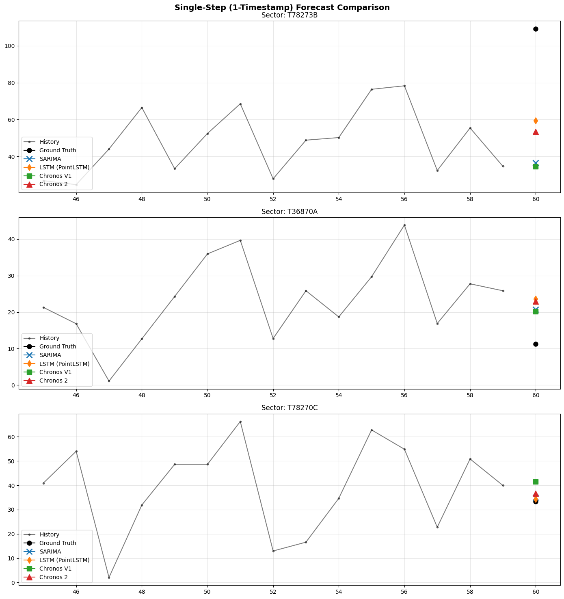
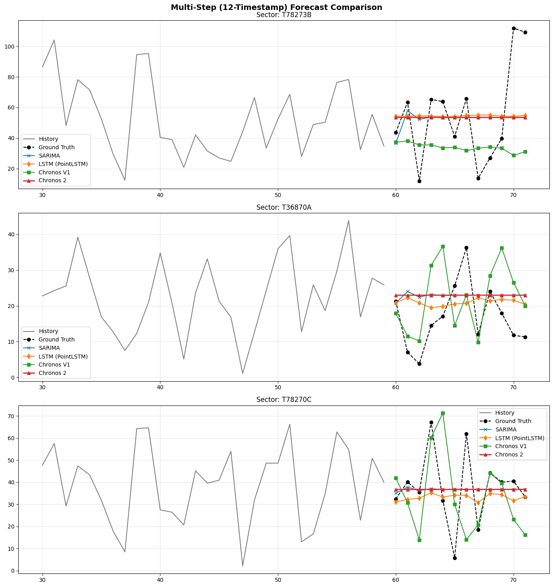

# LLMs for 6G Networks: Fine-Grained Telecom Traffic Generation and Forecasting

**Ahcene Loubar & Maryam Bachtti** — Laboratoire des Signaux et Systèmes (L2S), CentraleSupélec  
Supervisor: Alexis Aravanis · 📄 [Full report](docs/Project5_report.pdf) · 🖥️ [Slides](docs/Project5_presentation.pdf)

This project studies whether zero-shot time-series foundation models (Amazon **Chronos** and **Chronos 2**) can forecast fine-grained cellular traffic better than classical and deep-learning baselines (**SARIMA**, **LSTM**).

Operator traffic is only available as coarse 5-minute averages, which hide the bursts expected in 5G/6G networks. We therefore first **synthesise fine-grained traffic** with a KTH-style Interrupted Poisson Process (ON/OFF CTMC) that preserves the coarse volumes, then benchmark the models on 86 cell sectors for **1-step** and **12-step** horizons, using RMSE and pinball (quantile) loss.

## Repository layout

```
├── data/                  Raw operator data and the IPP-augmented dataset
│   ├── histo_trafic.csv            coarse 5-min traffic (raw)
│   ├── augmented_data.csv          fine-grained synthetic traffic (generated)
│   └── DIM prédictif 2024 - *      sector description / operator documentation
├── src/                   Reusable package
│   ├── config.py                   IPP parameters (KTHParams)
│   ├── data_loader.py              loading, aggregation, dataloaders
│   ├── kth_ipp.py                  coarse → fine traffic generator
│   ├── evaluate.py                 RMSE / pinball loss
│   └── models/                     SARIMA, LSTM, Chronos wrappers
├── scripts/               Command-line entry points
│   ├── generate_augmented.py       build data/augmented_data.csv
│   ├── tune_ipp.py                 grid of IPP (tau, zeta) → results/figures
│   ├── run_eval.py                 full SARIMA / LSTM / Chronos benchmark
│   ├── evaluate_sectors.py         per-sector SARIMA evaluation
│   ├── forecasting_pipeline.py     LSTM vs Chronos 2 quick pipeline
│   ├── create_lstm_exp.py          generates notebooks/03_lstm_experiments.ipynb
│   └── generate_final_nb.py        generates notebooks/05_ultimate_6G_evaluation.ipynb
├── notebooks/             Analysis, in reading order
│   ├── 01_explore_aggregated.ipynb
│   ├── 02_tuning_and_augmentation.ipynb
│   ├── 03_lstm_experiments.ipynb
│   ├── 04_full_evaluation.ipynb
│   └── 05_ultimate_6G_evaluation.ipynb   ← final results
├── results/
│   ├── figures/                    plots (forecasts, IPP tuning, aggregates)
│   ├── tables/                     benchmark tables (1-step, 12-step)
│   └── html/                       executed notebooks exported to HTML
├── docs/                  Report, slides, project subject, method notes
│   └── references/                 papers (KTH IPP, Chronos, …)
└── archive/               Earlier drafts of the evaluation scripts (not maintained)
```

## Getting started

```bash
git clone https://github.com/somehcene/Probabilistic-forcasting-using-LLMs-Application-on-5G-network-traffic-.git
cd Probabilistic-forcasting-using-LLMs-Application-on-5G-network-traffic-
python -m venv venv && source venv/bin/activate   # Windows: venv\Scripts\activate
pip install -r requirements.txt
```

Scripts can be launched from anywhere; they switch to the repository root themselves:

```bash
python scripts/generate_augmented.py   # 1. coarse → fine-grained traffic
python scripts/run_eval.py             # 2. benchmark all models
```

Notebooks can be opened from the `notebooks/` folder; their first cell sets the working directory to the repository root so that `data/` and `src/` resolve.

## Results

Benchmark tables are in [`results/tables/`](results/tables) and the forecast plots in [`results/figures/`](results/figures). The full write-up is in [`docs/Project5_report.pdf`](docs/Project5_report.pdf), with the slides in [`docs/Project5_presentation.pdf`](docs/Project5_presentation.pdf). Method details (IPP generator, models, metrics) are explained in [`docs/KTH_IPP_Explanation.md`](docs/KTH_IPP_Explanation.md).



